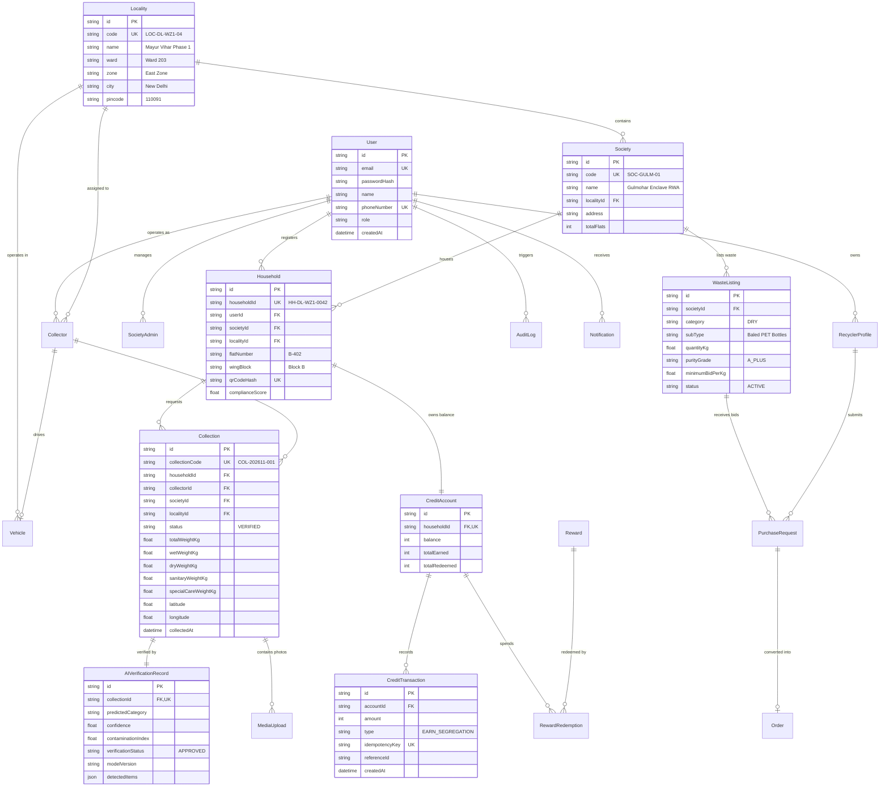

# EcoSetu – Database Architecture & Entity Relationship Design

## 1. Overview
The database uses **PostgreSQL 16** managed through **Prisma ORM**. The schema is strictly normalized (3NF), enforces referential integrity through foreign key constraints, implements unique constraints on business identifiers, and features b-tree composite indexes on frequently filtered query paths.

---

## 2. Mermaid Entity Relationship Diagram (ERD)

---

## 3. Database Indices & Performance Strategy
- `Household`: Index on `[societyId]`, `[localityId]`, and unique index on `householdId`.
- `Collection`: Composite index on `[householdId, createdAt]`, `[status]`, `[collectorId, status]`, and `[localityId, createdAt]`.
- `CreditTransaction`: Unique index on `idempotencyKey` prevents double-crediting if requests are retried.
- `AIVerificationRecord`: Index on `[verificationStatus, confidence]` for fast municipal flagged audit lookups.
- `WasteListing`: Index on `[status, category, purityGrade]` for marketplace search.

